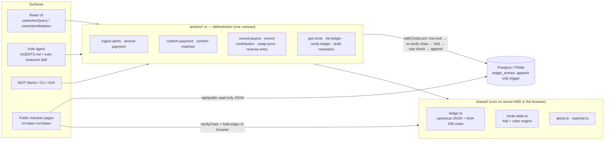

<p align="center">
  
</p>

<h1 align="center">Kolo: savings circles, kept honest</h1>

<p align="center">
<!-- badges:start -->
<!-- badges:end -->
</p>

**An AI treasurer for rotating savings groups** (ajo, esusu and adashi in Nigeria, susu in Ghana, chama in Kenya, stokvel in South Africa, tanda in Mexico, hui in China, chit funds in India). Organizers paste bank alerts; Kolo's agent matches every payment to a member and explains why, chases late payers through WhatsApp, and keeps a hash-chained ledger that every member can verify on their own phone, without trusting the organizer or Kolo's servers.

Built on [Agent-Native](https://agent-native.com) for the Builder.io Agent-Native Hackathon.

> Kolo keeps records. It never holds or moves money.

---

## The problem

Friends pool a fixed amount every week or month and take turns collecting the whole pot. These groups run on WhatsApp and trust, and they break in three places:

1. **Reconciliation.** The organizer matches dozens of bank SMS ("TRANSFER FROM ADEBAYO TUNDE O") to members from memory.
2. **Chasing.** Reminders feel personal, so they go out late; the round stalls.
3. **Default after payout.** Once someone has collected, the group carries the risk, and nobody can see how much.

## What Kolo does

| Capability | Where the AI helps | Where code decides |
|---|---|---|
| Paste a night's worth of alerts | Agent reads formats the parser can't and fixes misread fields | Deterministic parser for GTBank/Access/OPay/Moniepoint/M-Pesa/Zelle formats; duplicate alerts and bank references refused; debits skipped |
| Match payments to members | Agent explains uncertain matches, asks before guessing | Scored name matching (surname-first, initials, honorifics, learned bank aliases) + amount fit; split across rounds |
| Pay out the pot | Agent explains *why* a payout is blocked and offers reminders | Rules engine in a locked DB transaction: in order, fully funded, right recipient, exact pot |
| Reminders | Agent rewrites tone or language | Templates with exact ledger amounts, `wa.me` links, member link, current seal |
| Trust | — | Append-only, SHA-256 hash-chained ledger; DB trigger blocks UPDATE/DELETE; members' browsers re-verify every hash |

## The hard part, made visible

1. **The AI can't bend the money rules.** Ask the agent to "pay Emeka now" while two members haven't paid. `record-payout` refuses inside the transaction with `round_not_funded: Round 5 is short ₦100,000. Waiting on Bisi, Musa.`, and the agent relays it and offers reminders.
2. **Tampering is detectable by anyone.** In development, *Ledger → Simulate tampering* plays a dishonest DB admin: it disables the trigger and cuts one recorded amount. The circle page turns red, new writes are blocked (`ledger_integrity`), and the public member page says *"Entry #2 was changed after it was recorded."*
3. **Same action, every surface.** Each ledger entry records whether it came from the app, the agent, MCP, the CLI, or a scheduled job.

## Architecture



**Key design decisions**

- **Ledger as the single source of truth.** Balances, schedule, who's late and trust exposure are a pure fold over the ledger (`shared/circle-state.ts`). Nothing about money is stored anywhere else, so nothing can drift.
- **Integer minor units** everywhere; formatting only at the edge.
- **Per-circle serialization.** `withCircleLock` takes `SELECT … FOR UPDATE` on the circle row, re-reads and re-verifies the chain, then appends. Circles proceed in parallel; writers to one circle serialize. A broken chain blocks writes rather than burying the evidence.
- **Defence in depth.** Server rules, a database trigger, a unique `(circle_id, seq)` constraint, and client-side verification.
- **AI through the agent only.** Actions are deterministic; AI work goes through the agent chat (`sendToAgentChat`), per Agent-Native's rules.
- **Members need no account.** 128-bit tokens, read-only routes, no phones/aliases/emails exposed, `noindex`.

### Data model

| Table | Purpose |
|---|---|
| `circles` | Terms (editable only in draft), status, public token, cached chain head. Ownable/shareable via Agent-Native sharing |
| `circle_members` | Profile only: name, phone, learned bank aliases, personal token |
| `ledger_entries` | `seq`, `kind`, canonical `payload`, `prev_hash`, `hash`, `recorded_via`. Append-only trigger |
| `payment_signals` | Inbox: raw alert, parsed fields, fingerprint (unique per circle), proposal + confidence |
| `nudges` | Reminders actually sent |

## Run it

Requires Node ≥ 22.22 and pnpm.

```bash
pnpm install
pnpm dev            # http://localhost:8080 — local PGlite DB, migrations run on boot
```

Sign in with **Continue as local dev**, then **Explore a sample** to get a circle with four weeks of history, two late payers, and alerts in the inbox. Add an LLM key (Anthropic/OpenAI) in Settings → Agent, or `.env`, to talk to the agent.

The same actions from the terminal (while `pnpm dev` runs):

```bash
pnpm action list-circles
pnpm action record-payout --circleId <id> --round 4      # refused: round_not_funded
pnpm action verify-ledger --circleId <id>
```

### Deploy

Any Nitro target. Set `DATABASE_URL` (Postgres: Neon, Supabase, RDS) and `BETTER_AUTH_SECRET`, run `pnpm migrate:production`, then `pnpm build`.

## Tests

<!-- tests:start -->
<!-- tests:end -->

```bash
pnpm test         # unit tests (Vitest): ledger tamper detection, payout rules, parser formats, matcher, schedule, money
pnpm test:e2e     # end-to-end tests (Playwright): landing demos, organizer workflow, member verification, accessibility, performance
pnpm test:all     # both, then writes the counts above and the badges from the actual results
pnpm typecheck    # strict: noUncheckedIndexedAccess + exactOptionalPropertyTypes
```

What each suite covers, and how to run it, is in [docs/TESTING.md](docs/TESTING.md). System design and latency budgets are in [docs/ARCHITECTURE.md](docs/ARCHITECTURE.md).

## Limitations

- Kolo records money; it does not move it. Payouts are recorded after the organizer transfers.
- Bank-alert parsing covers common formats; others go through the agent (`amend-payment`), and anything unreadable stays in the inbox for a person.
- Verification proves the ledger wasn't altered *after* entries were recorded; it can't prove a recorded payment happened in the real world. That's why every entry links to its source alert and members hold the seal from reminders.
- Seal anchoring is social (seals travel in WhatsApp reminders); there is no external timestamping service yet.
- Reminder templates: English, Nigerian Pidgin, French, Spanish, Swahili. Other languages come from the agent.
- WhatsApp sending is user-initiated via `wa.me` links, with no WhatsApp Business API integration.

## Project

- [Contributing](CONTRIBUTING.md) · [Code of Conduct](CODE_OF_CONDUCT.md) · [Security](SECURITY.md) · [Privacy](PRIVACY.md)
- Licensed under the [MIT License](LICENSE).
