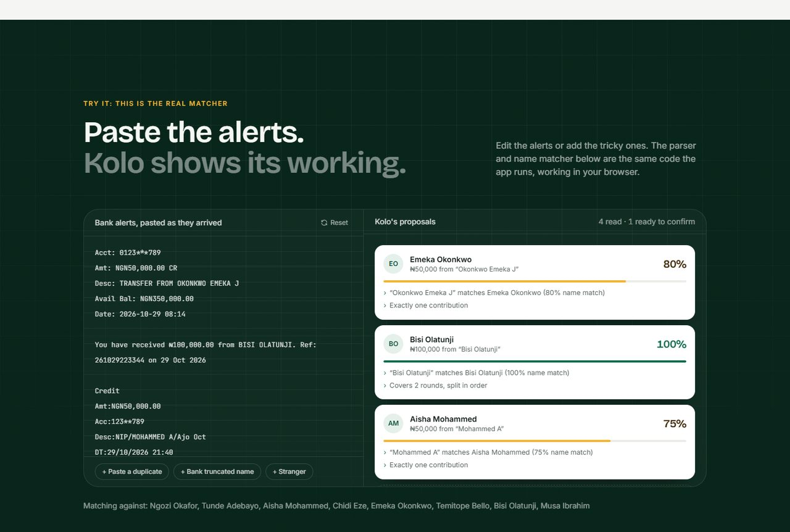
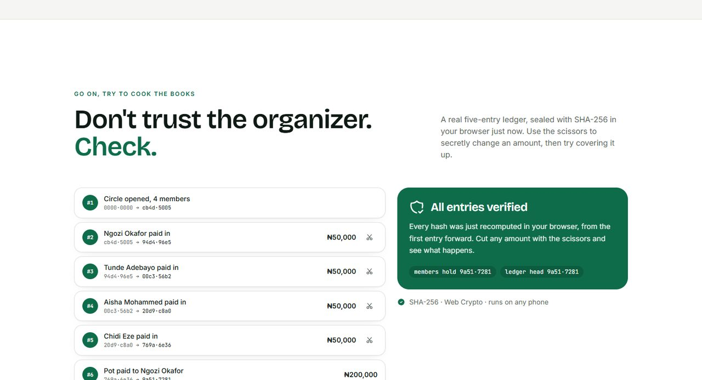
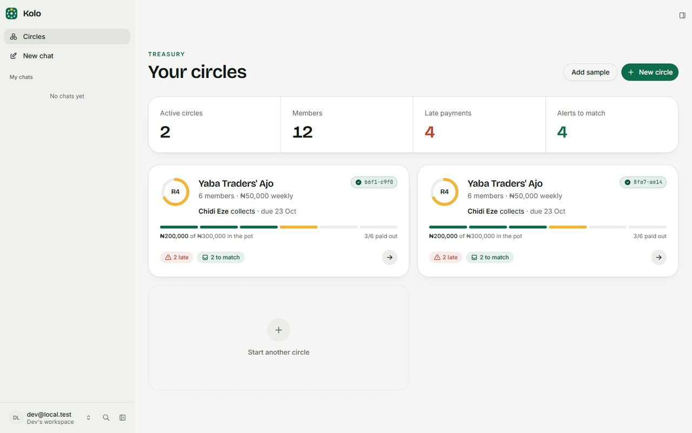
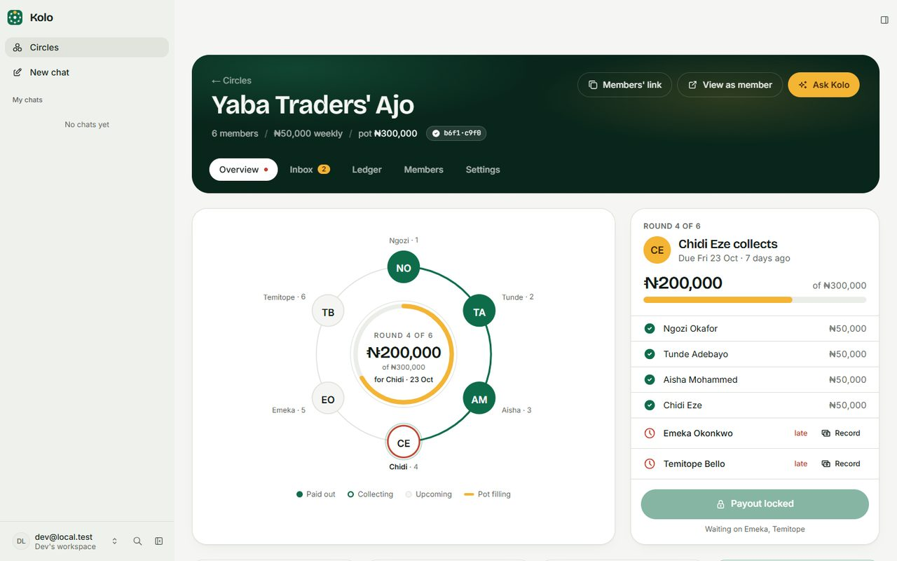
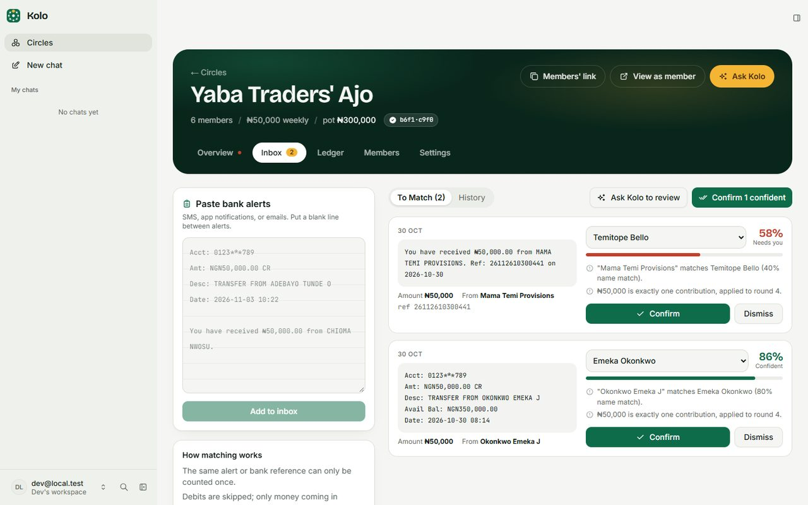
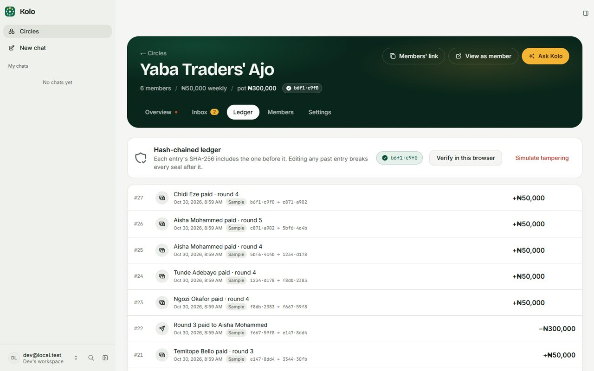
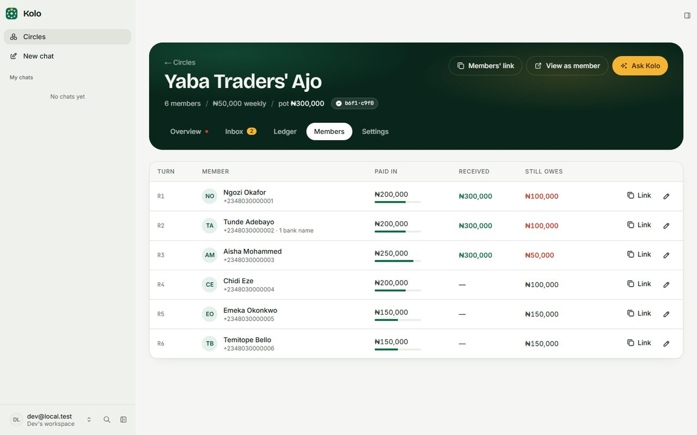
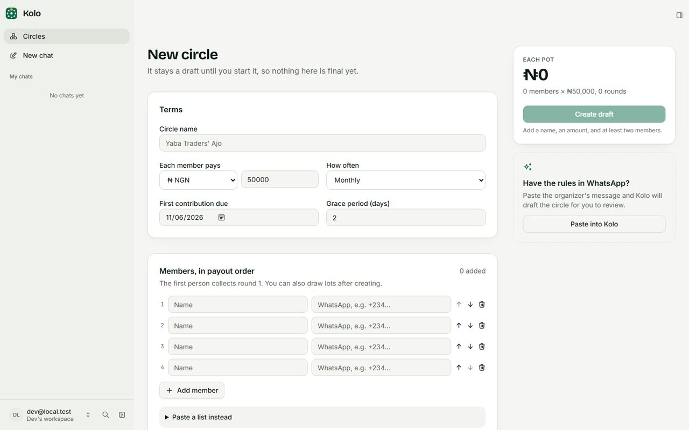
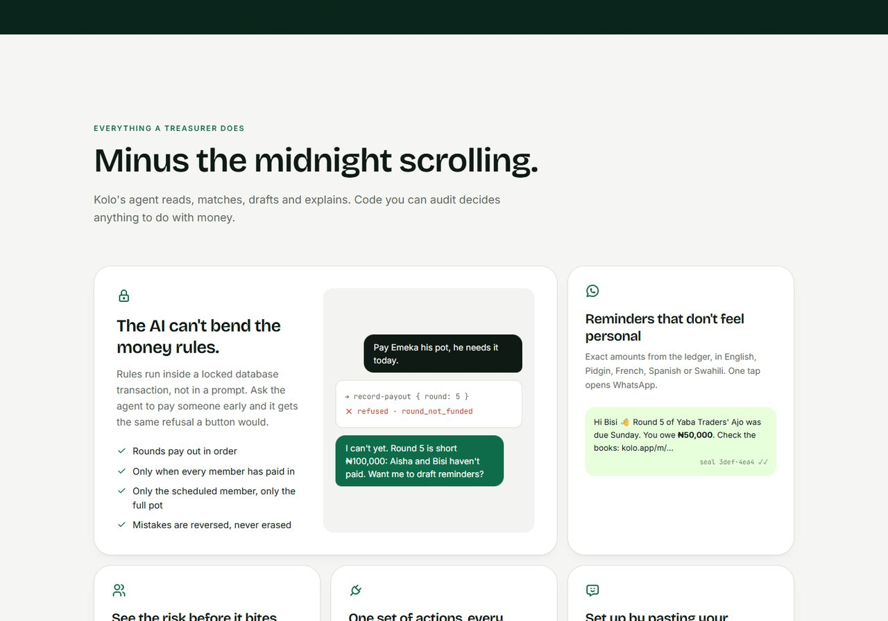
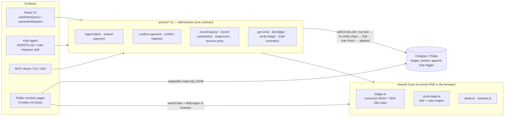

<p align="center">
  
</p>

<h1 align="center">Kolo</h1>

<p align="center"><b>Savings circles, kept honest.</b><br/>An AI treasurer for ajo, esusu, susu, chama, stokvel and tanda groups, with a ledger every member can verify on their own phone.</p>

<p align="center"><a href="https://kolo-62vk.vercel.app"><b>Live app: kolo-62vk.vercel.app</b></a></p>

<p align="center">
<a href="https://kolo-62vk.vercel.app"></a>
<a href="https://github.com/opeblow/KOLO/actions/workflows/ci.yml"></a>
<a href="https://github.com/opeblow/KOLO/actions/workflows/codeql.yml"></a>
</p>

<p align="center">
<!-- badges:start -->
<a href="https://github.com/opeblow/KOLO/actions/runs/41123707776"></a>
<a href="https://github.com/opeblow/KOLO/actions/runs/41123707776"></a>


<!-- badges:end -->
</p>

<p align="center">
<a href="https://kolo-62vk.vercel.app">Live app</a> ·
<a href="#screenshots">Screenshots</a> ·
<a href="#run-it">Run it</a> ·
<a href="docs/ARCHITECTURE.md">System design</a> ·
<a href="docs/TESTING.md">Testing</a> ·
<a href="CONTRIBUTING.md">Contributing</a>
</p>

<p align="center"></p>

Organizers paste bank alerts. Kolo's agent matches every payment to a member and explains why, chases late payers through WhatsApp, and keeps a SHA-256 hash-chained ledger that members verify in their own browser, without trusting the organizer or Kolo's servers.

> Kolo keeps records. It never holds or moves money.

Built on [Agent-Native](https://agent-native.com) for the Builder.io Agent-Native Hackathon.

**Try it now:** [https://kolo-62vk.vercel.app](https://kolo-62vk.vercel.app). Paste bank alerts into the live matcher on the landing page, or try to tamper with the sample ledger. No sign-up needed.

## Table of contents

<table>
<tr>
<td valign="top" width="33%">

**Product**

1. [Highlights](#highlights)
2. [Screenshots](#screenshots)
3. [The problem](#the-problem)
4. [What Kolo does](#what-kolo-does)
5. [The hard part, made visible](#the-hard-part-made-visible)
6. [Limitations](#limitations)

</td>
<td valign="top" width="33%">

**Engineering**

7. [Built on Agent-Native](#built-on-agent-native)
   - [One action, every surface](#one-action-every-surface)
   - [An agent that knows the rules](#an-agent-that-knows-the-rules)
   - [UI and agent share one screen](#ui-and-agent-share-one-screen)
   - [Guardrails the framework enforces](#guardrails-the-framework-enforces)
8. [Architecture](#architecture) · [Data model](#data-model)
9. [Security and trust](#security-and-trust)
10. [Performance](#performance)
11. [Tech stack](#tech-stack)
12. [Project structure](#project-structure)

</td>
<td valign="top" width="33%">

**Use and contribute**

13. [Run it](#run-it) · [Deploy](#deploy)
14. [Tests](#tests)
15. [Continuous integration](#continuous-integration)
16. [Roadmap](#roadmap)
17. [Acknowledgements](#acknowledgements)
18. [Project](#project)

</td>
</tr>
</table>

## Highlights

- **Paste, don't type.** A whole night of bank SMS in one paste. Six bank formats are parsed in code; the agent reads the rest.
- **Every match shows its working.** A confidence score plus the evidence ("OKONKWO EMEKA J" matches Emeka Okonkwo, exactly one contribution). Correct a match once and Kolo learns that bank's spelling.
- **The AI can't move the goalposts.** Eight money rules run inside a locked database transaction. The agent gets the same refusal a button does.
- **Tamper-evident by anyone.** A SHA-256 hash chain that every member's phone re-verifies, with seals that travel in WhatsApp reminders.
- **No accounts for members, no bank logins for anyone.** Members open a private link; organizers paste alerts they already receive.
- **One codebase, five surfaces.** The app, the in-app agent, Claude via MCP, the CLI and scheduled jobs all call the same typed actions.

## Screenshots

| | |
|---|---|
|  |  |
| **Live matcher.** Paste real bank SMS on the landing page; the same parser and name matcher the app uses run in the visitor's browser and show their reasoning. | **Try to cook the books.** A real SHA-256 ledger built in the browser. Cut an amount and the chain breaks; rehash to cover it up and the members' seal stops matching. |
|  |  |
| **Treasury.** Every circle at a glance: late payments, alerts waiting, and a progress ring for the current pot. | **Circle overview.** The rotation ring, who has paid this round, and a payout button that stays locked until the round is fully funded. |
|  |  |
| **Payment inbox.** Pasted alerts become proposals with a confidence score and the evidence behind it. Confirm in one tap. | **Hash-chained ledger.** Append-only entries, each sealed to the one before. Verify the whole chain in the browser. |
|  |  |
| **Members.** Payout order, what each member has paid and still owes, and their private verification link. | **New circle.** Terms and payout order in one form, or paste the group's rules from WhatsApp and let the agent draft it. |

<p align="center"></p>

## The problem

Friends pool a fixed amount every week or month and take turns collecting the whole pot. These groups run on WhatsApp and trust, and they break in three places:

1. **Reconciliation.** The organizer matches dozens of bank SMS ("TRANSFER FROM ADEBAYO TUNDE O") to members from memory.
2. **Chasing.** Reminders feel personal, so they go out late; the round stalls.
3. **Default after payout.** Once someone has collected, the group carries the risk, and nobody can see how much.

## What Kolo does

| Capability | Where the AI helps | Where code decides |
|---|---|---|
| Paste a night's worth of alerts | Agent reads formats the parser can't and fixes misread fields | Deterministic parser for GTBank/Access/OPay/Moniepoint/M-Pesa/Zelle formats; duplicate alerts and bank references refused; debits skipped |
| Match payments to members | Agent explains uncertain matches, asks before guessing | Scored name matching (surname-first, initials, honorifics, learned bank aliases) + amount fit; split across rounds |
| Pay out the pot | Agent explains *why* a payout is blocked and offers reminders | Rules engine in a locked DB transaction: in order, fully funded, right recipient, exact pot |
| Reminders | Agent rewrites tone or language | Templates with exact ledger amounts, `wa.me` links, member link, current seal |
| Trust | — | Append-only, SHA-256 hash-chained ledger; DB trigger blocks UPDATE/DELETE; members' browsers re-verify every hash |

## The hard part, made visible

1. **The AI can't bend the money rules.** Ask the agent to "pay Emeka now" while two members haven't paid. `record-payout` refuses inside the transaction with `round_not_funded: Round 5 is short ₦100,000. Waiting on Bisi, Musa.`, and the agent relays it and offers reminders.
2. **Tampering is detectable by anyone.** In development, *Ledger → Simulate tampering* plays a dishonest DB admin: it disables the trigger and cuts one recorded amount. The circle page turns red, new writes are blocked (`ledger_integrity`), and the public member page says *"Entry #2 was changed after it was recorded."*
3. **Same action, every surface.** Each ledger entry records whether it came from the app, the agent, MCP, the CLI, or a scheduled job.

## Built on Agent-Native

Kolo is an [Agent-Native](https://agent-native.com) app: the agent is a first-class user of the same capabilities as the UI, not a chatbot bolted on the side. Here is how we used the framework, and why it matters for money.

### One action, every surface

Every capability is a single `defineAction` in [`actions/`](actions). Its Zod schema is the contract for the React UI, the in-app agent, MCP clients such as Claude, the CLI, and A2A. The description doubles as the agent's instructions, so the rules travel with the tool:

```ts
// actions/record-payout.ts (abridged)
export default defineAction({
  description:
    "Record that a round's pot was paid to its recipient. Enforced rules that nobody (including you) can override: " +
    "rounds pay in order, the round must be fully funded, the recipient must be the scheduled member…",
  schema: z.object({ circleId: circleIdArg, round: z.number().int().min(1) /* … */ }),
  run: async (args, ctx) =>
    withCircleLock(args.circleId, "editor", async (locked) => {
      const state = requireActive(locked);
      const violation = checkPayout(state, { round: args.round /* … */ });
      if (violation) failRule(violation); // 409: round_not_funded, out_of_order, …
      return appendOne(locked, { kind: "payout" /* … */ }, viaFromCaller(ctx));
    }),
});
```

| Surface | How it calls `record-payout` | Recorded as |
|---|---|---|
| React UI | `useActionMutation("record-payout")` | `app` |
| Kolo agent | Tool call from the chat sidebar | `agent` |
| Claude Desktop or any MCP client | MCP tool | `mcp` |
| Terminal | `pnpm action record-payout --circleId … --round 5` | `cli` |
| Scheduled job | The same action from a job | `job` |

One code path means one set of rules. A refusal reads the same everywhere: `round_not_funded: Round 5 is short ₦100,000. Waiting on Bisi, Musa.`

### An agent that knows the rules

- **[`AGENTS.md`](AGENTS.md)** gives the agent the domain model, the action catalogue and the hard rules: money lives only in the ledger, and refusals are final.
- **[`.agents/skills/kolo-treasurer`](.agents/skills/kolo-treasurer/SKILL.md)** is a workflow skill: how to process a paste, when to bulk-confirm (85% and up), when to ask (60–84%), and never to invent contributions to unblock a payout.
- **AI stays in the agent.** Actions are deterministic. Judgment work, like reading an unfamiliar bank format, softening a reminder or explaining a refusal, goes through the agent chat with `sendToAgentChat`, which carries the circle as context.

### UI and agent share one screen

- **Navigation state** (`circleId`, `tab`) is published to the agent, so "remind whoever's late" needs no IDs. `view-screen` gives it a fresh read of what the organizer sees.
- **Ask Kolo** buttons hand the current circle to the agent sidebar with a ready prompt, for example a treasurer's check of who's late, what's in the inbox, and whether the round can pay out.
- **Live sync.** When the agent writes, `useDbSync` refreshes every open tab, so the organizer watches the inbox clear in real time.
- **Ownership and sharing** use Agent-Native's access model: `withCircleLock(circleId, "editor")` checks the caller can edit before touching the ledger.

### Guardrails the framework enforces

`pnpm agent-native:doctor` runs 14 static guards in CI, including scoped queries, no credentials read from `process.env`, explicit collaboration access, and migration hygiene. Kolo passes with no findings.

## Architecture



**Key design decisions**

- **Ledger as the single source of truth.** Balances, schedule, who's late and trust exposure are a pure fold over the ledger (`shared/circle-state.ts`). Nothing about money is stored anywhere else, so nothing can drift.
- **Integer minor units** everywhere; formatting only at the edge.
- **Per-circle serialization.** `withCircleLock` takes `SELECT … FOR UPDATE` on the circle row, re-reads and re-verifies the chain, then appends. Circles proceed in parallel; writers to one circle serialize. A broken chain blocks writes rather than burying the evidence.
- **Defence in depth.** Server rules, a database trigger, a unique `(circle_id, seq)` constraint, and client-side verification.
- **AI through the agent only.** Actions are deterministic; AI work goes through the agent chat (`sendToAgentChat`), per Agent-Native's rules.
- **Members need no account.** 128-bit tokens, read-only routes, no phones/aliases/emails exposed, `noindex`.

### Data model

| Table | Purpose |
|---|---|
| `circles` | Terms (editable only in draft), status, public token, cached chain head. Ownable/shareable via Agent-Native sharing |
| `circle_members` | Profile only: name, phone, learned bank aliases, personal token |
| `ledger_entries` | `seq`, `kind`, canonical `payload`, `prev_hash`, `hash`, `recorded_via`. Append-only trigger |
| `payment_signals` | Inbox: raw alert, parsed fields, fingerprint (unique per circle), proposal + confidence |
| `nudges` | Reminders actually sent |

## Security and trust

| Layer | Protection |
|---|---|
| Database | Trigger blocks `UPDATE`/`DELETE` on `ledger_entries`; unique `(circle_id, seq)` |
| Write path | `withCircleLock`: row lock → re-verify chain → rule check → append, in one transaction |
| Hash chain | SHA-256 over canonical JSON; each entry commits to the previous hash |
| Members | Browsers re-verify the whole chain; seals in WhatsApp reminders catch a rewritten chain |
| Privacy | Public pages show names and the ledger only, never phones, bank aliases or emails; 128-bit links; `noindex` |

Threat model and reporting: [SECURITY.md](SECURITY.md) · Data handling: [PRIVACY.md](PRIVACY.md) · Full design: [docs/ARCHITECTURE.md](docs/ARCHITECTURE.md)

## Performance

Measured locally on 30 October 2026:

| Metric | Result | Budget |
|---|---|---|
| Landing page, time to first byte (production build) | 28–45 ms | < 200 ms |
| Landing page, cumulative layout shift (production build) | 0.00004 | < 0.1 |
| Public ledger API, warm request | 30–44 ms | < 200 ms |
| Ledger verification in the browser | One linear SHA-256 pass; the on-screen check is paced so members can watch it | < 50 ms compute for 500 entries |

How: server-side rendering; public pages skip the app shell and session sync; fonts are preloaded; scroll reveals use CSS, not JavaScript; demos use `useDeferredValue` and async Web Crypto. Budgets are enforced in [`e2e/perf.spec.ts`](e2e/perf.spec.ts) and [`e2e/api.spec.ts`](e2e/api.spec.ts).

## Tech stack

| Layer | Technology |
|---|---|
| Framework | [Agent-Native](https://agent-native.com): actions, agent, MCP, sharing, doctor guards |
| Front end | React 19, React Router 8 (SSR), Tailwind CSS 4, Radix UI, Tabler icons |
| Server | Nitro, h3 |
| Data | Drizzle ORM · Postgres in production (Neon, Supabase, RDS) · PGlite locally |
| Integrity | SHA-256 via Web Crypto, shared by server and browser |
| AI | Any provider through the AI SDK: Anthropic, OpenAI, Google, Groq, Mistral, OpenRouter, Ollama |
| Testing | Vitest, Playwright, axe-core |
| CI | GitHub Actions, CodeQL, Dependabot |

## Project structure

```text
kolo/
├── actions/                  # One typed action per capability, shared by UI, agent, MCP and CLI
│   ├── ingest-alerts.ts      #   pasted bank alerts → parsed, de-duplicated inbox
│   ├── confirm-payment.ts    #   inbox → ledger (rules checked under lock)
│   ├── record-payout.ts      #   guarded payout: in order, fully funded, right recipient
│   ├── verify-ledger.ts      #   recompute the whole hash chain
│   └── …                     #   30 action files in total
├── app/                      # React Router 8 front end (SSR)
│   ├── routes/               #   /, /circles, /circles/:id, /v/:token, /m/:token
│   ├── components/
│   │   ├── landing/          #   landing page and live demos
│   │   ├── circle/           #   overview, inbox, ledger, members, settings tabs
│   │   ├── public/           #   member verification page
│   │   └── kolo/             #   brand mark, seal, rotation ring
│   └── global.css            #   design tokens (light and dark)
├── shared/                   # Pure core that runs on the server and in the browser
│   ├── ledger.ts             #   canonical JSON + SHA-256 chain + verifyChain
│   ├── circle-state.ts       #   ledger fold and the rules engine
│   ├── alerts.ts             #   bank-alert parser (GTBank, Access, OPay, M-Pesa, Zelle…)
│   ├── matcher.ts            #   sender-name → member matching with reasons
│   ├── money.ts              #   integer minor units and formatting
│   └── schedule.ts           #   due dates per cadence
├── server/                   # Nitro server
│   ├── db/                   #   Drizzle schema (append-only ledger trigger)
│   ├── lib/                  #   withCircleLock, public view, reminders
│   └── routes/api/public/    #   read-only member JSON
├── tests/                    # Unit tests (Vitest)
├── e2e/                      # End-to-end tests (Playwright)
├── scripts/                  # test runner and badge sync
├── docs/                     # architecture, testing, logo, screenshots
├── .github/                  # CI, CodeQL, Dependabot, templates
└── AGENTS.md                 # Agent guide and action catalogue
```

## Run it

Requires Node ≥ 22.22 and pnpm.

```bash
pnpm install
pnpm dev            # http://localhost:8080 — local PGlite DB, migrations run on boot
```

Sign in with **Continue as local dev**, then **Explore a sample** to get a circle with four weeks of history, two late payers, and alerts in the inbox. Add an LLM key (Anthropic/OpenAI) in Settings → Agent, or `.env`, to talk to the agent.

The same actions from the terminal (while `pnpm dev` runs):

```bash
pnpm action list-circles
pnpm action record-payout --circleId <id> --round 4      # refused: round_not_funded
pnpm action verify-ledger --circleId <id>
```

### Deploy

Any Nitro target. Set `DATABASE_URL` (Postgres: Neon, Supabase, RDS) and `BETTER_AUTH_SECRET`, run `pnpm migrate:production`, then `pnpm build`.

## Tests

<!-- tests:start -->
**[CI run on 30 October 2026](https://github.com/opeblow/KOLO/actions/runs/41123707776): 52/52 unit tests and 17/17 end-to-end tests passing** (69/69 total) on Ubuntu 24.04.
<!-- tests:end -->

```bash
pnpm test         # unit tests (Vitest): ledger tamper detection, payout rules, parser formats, matcher, schedule, money
pnpm test:e2e     # end-to-end tests (Playwright): landing demos, organizer workflow, member verification, accessibility, performance
pnpm test:all     # both, then writes the counts above and the badges from the actual results
pnpm typecheck    # strict: noUncheckedIndexedAccess + exactOptionalPropertyTypes
```

What each suite covers, and how to run it, is in [docs/TESTING.md](docs/TESTING.md). System design and latency budgets are in [docs/ARCHITECTURE.md](docs/ARCHITECTURE.md).

## Continuous integration

Every push and pull request runs [`.github/workflows/ci.yml`](.github/workflows/ci.yml):

| Job | Runs |
|---|---|
| Typecheck, guards and unit tests | `pnpm typecheck`, `pnpm agent-native:doctor`, `pnpm test` |
| Production build | `pnpm build`, uploaded as an artifact |
| End-to-end tests | Playwright against the production build and dev server; HTML report uploaded as an artifact |

[CodeQL](.github/workflows/codeql.yml) scans the code weekly and on every pull request. Dependabot keeps npm packages and Actions current.

## Limitations

- Kolo records money; it does not move it. Payouts are recorded after the organizer transfers.
- Bank-alert parsing covers common formats; others go through the agent (`amend-payment`), and anything unreadable stays in the inbox for a person.
- Verification proves the ledger wasn't altered *after* entries were recorded; it can't prove a recorded payment happened in the real world. That's why every entry links to its source alert and members hold the seal from reminders.
- Seal anchoring is social (seals travel in WhatsApp reminders); there is no external timestamping service yet.
- Reminder templates: English, Nigerian Pidgin, French, Spanish, Swahili. Other languages come from the agent.
- WhatsApp sending is user-initiated via `wa.me` links, with no WhatsApp Business API integration.

## Roadmap

- [ ] External timestamping of seals (for example OpenTimestamps), on top of WhatsApp-anchored seals
- [ ] WhatsApp Business API for one-tap sending, opt-in
- [ ] Forwarded bank notifications (SMS or email), so alerts arrive without pasting
- [ ] More bank formats: Kuda, Palmpay, Wema/ALAT, Equity, MTN MoMo
- [ ] Member self-reporting ("I paid"), matched against the organizer's alerts
- [ ] Offline-first member page (PWA) for low-connectivity areas

## Acknowledgements

- [Agent-Native](https://agent-native.com) and the Builder.io team, for the framework and the hackathon.
- The organizers of ajo, esusu, susu, chama, stokvel and tanda groups, whose midnight reconciliations inspired Kolo.
- [Contributor Covenant](https://www.contributor-covenant.org), for the code of conduct.

## Project

- [Contributing](CONTRIBUTING.md) · [Code of Conduct](CODE_OF_CONDUCT.md) · [Security](SECURITY.md) · [Privacy](PRIVACY.md)
- Licensed under the [MIT License](LICENSE).
