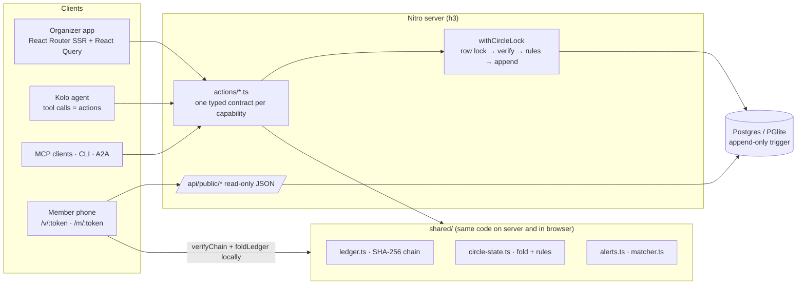

# Kolo system design

Kolo is an AI treasurer for rotating savings circles. Its design goal is that **no one — the organizer, the AI agent, or Kolo's own servers — can change the money record without being caught.**

## 1. Components

| Layer | Choice | Why |
|---|---|---|
| UI | React 19, React Router 8 (SSR), Tailwind 4 | Server-rendered first paint; public pages skip the app shell |
| API | Agent-Native actions (`defineAction`) | One contract serves the UI, agent, MCP and CLI, so rules cannot drift between surfaces |
| Data | Drizzle ORM on Postgres (production) or PGlite (local) | Real transactions and row locks; zero-setup local development |
| Integrity | SHA-256 hash chain via Web Crypto | Same verification code runs on any phone without trusting the server |
| AI | Agent chat only; actions stay deterministic | The model can propose and explain, never bypass a rule |

## 2. Data model

| Table | Notes |
|---|---|
| `circles` | Terms (frozen once active), status, public token, cached chain head `(head_seq, head_hash)` |
| `circle_members` | Name, phone, learned bank aliases, personal token. **No balances.** |
| `ledger_entries` | `(circle_id, seq)` unique; `kind`, canonical `payload`, `prev_hash`, `hash`, `recorded_via`. Trigger blocks `UPDATE`/`DELETE` |
| `payment_signals` | Pasted alerts: raw text, parsed fields, fingerprint (unique per circle), proposal + confidence |
| `nudges` | Reminders sent |

**Single source of truth.** Every balance, schedule, late list and exposure figure is a pure function `foldLedger(entries)`. Nothing derived is stored, so nothing can drift.

**Money** is integer minor units end to end. Formatting happens only in the UI.

## 3. The write path

Every money-changing action runs the same sequence inside one database transaction:

1. `SELECT … FOR UPDATE` on the circle row. Writers to one circle serialize; different circles run in parallel.
2. Read the ledger and **re-verify the chain**. If it is broken, refuse with `ledger_integrity` so evidence can't be buried under new entries.
3. `foldLedger` → current state.
4. Run the rule (`checkPayout`, `checkContribution`, …). A violation returns HTTP 409 with a code and a plain-language message.
5. Seal the new entry (`sha256(version, seq, prev_hash, kind, recorded_at, canonicalJson(payload))`), insert it, and update the cached head.

Idempotency: alert fingerprints and bank references are unique per circle, so pasting the same alert twice is refused. The `(circle_id, seq)` constraint makes a lost race fail loudly instead of forking the chain.

## 4. Trust model

| Threat | Defence | Detected by |
|---|---|---|
| Organizer edits an amount in the database | Append-only trigger; hash chain | Server re-verification on next write; every member's browser |
| Admin disables the trigger and rewrites history, then rehashes everything after | New head no longer matches the seal members already hold from WhatsApp reminders | Members comparing seals |
| Agent asked to "just pay Emeka" | Rules run in the transaction, not the prompt | 409 `round_not_funded` |
| Stranger guesses member links | 128-bit random tokens, read-only routes, `noindex` | — |
| Public page leaks personal data | Public bundle whitelists fields: names and ledger only | `e2e/member.spec.ts` |

Limit: verification proves records weren't changed after they were written. It can't prove a recorded payment happened in the real world. That's why each entry links to its source alert.

## 5. Latency budget

| Interaction | Target | How |
|---|---|---|
| Click feedback | < 100 ms | Optimistic UI and pending states before the network call |
| Landing first paint | LCP < 2.5 s on 4G | SSR; no app shell, auth or sync on public routes; system-font fallback; CSS-only scroll reveals |
| Landing interactivity | No blocking | Matcher demo uses `useDeferredValue`; hashing is async Web Crypto |
| Public ledger API | p95 < 200 ms server time | Two indexed reads (`members`, `ledger_entries` by `circle_id`), no joins; ~10 KB JSON for a 27-entry circle |
| Member verification | < 50 ms compute for 500 entries | Linear SHA-256 pass in the browser. The visible step-by-step animation is ~0.7 s on purpose so members see the check happen |
| Payout / contribution write | p95 < 300 ms | One transaction; work grows linearly with ledger length (re-verify + fold) |
| Layout stability | CLS < 0.1 | Fixed-size skeletons that match final layouts |

Measured on the local dev server (30 October 2026): `/api/public/circle/:token` answered in 30–44 ms warm. CLS and LCP are asserted in `e2e/perf.spec.ts`; run with `E2E_STRICT=1` against a production build to enforce the production budgets.

### Scaling notes

- **Long-lived circles.** Re-verifying the full chain on every write is linear in ledger length. Circles rarely exceed a few hundred entries. Past ~5,000 entries, verify from the cached head and run full verification in a scheduled job.
- **Hot circles.** Writes to one circle serialize on its row lock. That is intended: an organizer pasting 40 alerts confirms them in one `confirm-matches` transaction rather than 40.
- **Read scale.** Public pages are read-only and cacheable per token. Add `Cache-Control: private, max-age=30` with `ETag = head_hash` so repeat visits cost a 304.
- **Database.** Index `ledger_entries(circle_id, seq)`, `payment_signals(circle_id, status)` and `circle_members(member_token)`. Any Postgres host works (Neon, Supabase, RDS).

## 6. Observability

- Each ledger entry records `recorded_via` (`app`, `agent`, `mcp`, `cli`, `job`), so every change has an audit trail by surface.
- Rule refusals are structured error codes, so they can be counted per code.
- `@agent-native/otel` is installed for traces; export to any OTLP backend.

## 7. Testing strategy

See [TESTING.md](TESTING.md). Unit tests cover the pure core (`shared/`). End-to-end tests drive a real browser through the landing demos, the organizer workflow, member verification, accessibility and performance budgets.
